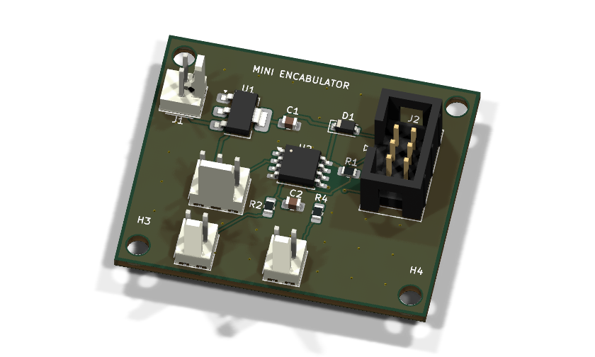
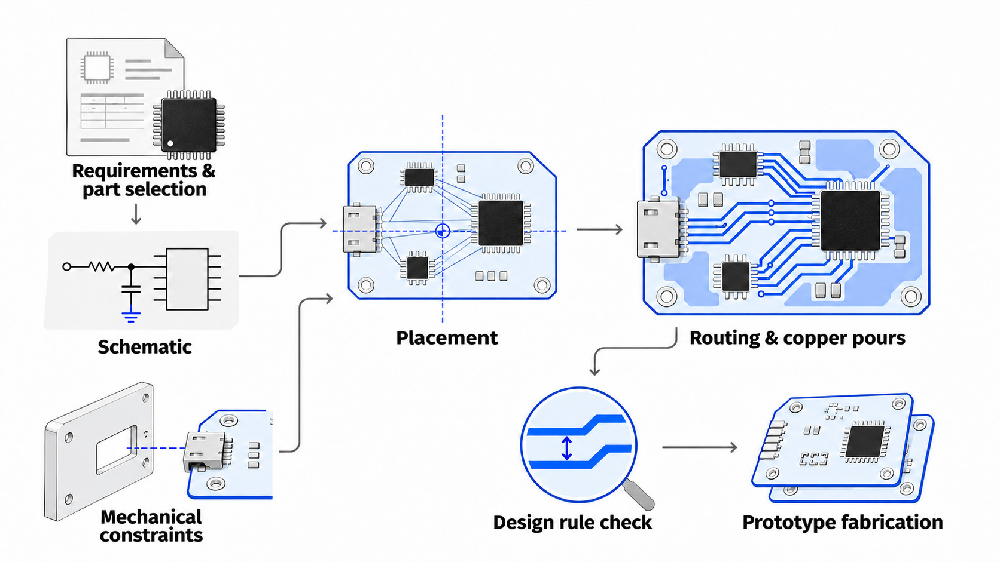

<h1 align="center"> Roadbook AI4PCB</h1>

Hardware engineers and researchers at SIGVoid maintain Roadbook AI4PCB. We study which parts of printed circuit board (PCB) design engineers can already hand over to AI. Here you can read research papers and engineering notes, or open a board file to see which connections a model got right. We are testing how well models read circuit diagrams, place parts, and connect them. We are also building training datasets from the steps engineers take to design a board and the checks they use to verify it.

<p align="center"><strong>English</strong> · <a href="README.zh-CN.md">中文</a> &nbsp; | &nbsp; <a href="https://sig-void.github.io/Roadbook-AI4PCB/">Explore the full roadbook ↗</a></p>

[Selected papers](#read-papers) · [Benchmarks and submissions](#read-benchmarks) · [Run a Harbor example](#read-harbor) · [Data and weights](#read-data) · [PCB engineering notes](#read-boards) · [Contribute](#read-contribute)

<a name="read-papers"></a>

## Where can AI help with PCB design?

A schematic specifies which pins belong together. Placement sets the positions of the components. Routing adds the copper that connects their pads. Each paper below produces a different artifact you can inspect.

| Engineering question | Paper and project | What to inspect |
| --- | --- | --- |
| Can a model recover connections from a drawing? | [OmniSch paper](https://arxiv.org/abs/2604.00270) · [Examples and data](https://www.omnisch.com/) | Locate components and wires in a schematic. Compare the extracted connections with the netlist, which records which pins belong together. |
| Can a model draw an editable schematic from a requirement? | [SchGen paper](https://arxiv.org/abs/2605.30345) · [Code and examples](https://github.com/microsoft/SchGen) | Follow a 3.3 V regulator example from a written requirement to a KiCad schematic. Check the power pins in the result. |
| Will a proposed placement leave room for routing? | [RL_PCB paper](https://past.date-conference.com/proceedings-archive/2024/DATA/1040_pdf_upload.pdf) · [Test circuits](https://github.com/LukeVassallo/RL_PCB) | The model moves components. A router connects the resulting layout so the authors can compare placements by actual trace length. |
| Can an agent finish routing a board? | [PCBWorld environment](https://github.com/LGAI-Research/PCBWorld) · [PCBRouteAgent paper](https://arxiv.org/abs/2611.08175) | Starting from a placed board, the agent chooses the routing order and where to change layers. Inspect the final board in KiCad. |
| Can a model learn from routing actions? | [CADET paper](https://arxiv.org/abs/2611.16913) · [Generation and replay code](https://github.com/LGAI-Research/CADET) | Generate routing demonstrations, replay them in a fresh environment, and compare imitation learning with reinforcement learning. |

[Browse all papers by design stage →](https://sig-void.github.io/Roadbook-AI4PCB/research/papers/)

<a name="read-benchmarks"></a>

## Benchmarks and model submissions

**Agents’ Last Exam (ALE)** includes two KiCad tasks. The layout task starts with a schematic and asks for a routed board that fits a specified enclosure. The repair task asks the model to restore the footprint for U4 on a navigation switch board and export the manufacturing files.

SIGVoid ran each model once on each task in the ALE v1.1 Windows environment. The maximum score is 1 per task. Each ZIP contains the submitted files, a step-by-step action log, and the score.

| Model and reasoning setting | Board layout and routing | Navigation switch repair |
| --- | --- | --- |
| DeepSeek V4.1 Flash · max | **1** · [Submission and actions](https://sig-void.github.io/Roadbook-AI4PCB/assets/runs/ale-mini-deepseek.zip) | **0** · [Submission and actions](https://sig-void.github.io/Roadbook-AI4PCB/assets/runs/ale-navswitch-deepseek.zip) |
| Qwen4-Max-Preview · xhigh | **0** · [Submission and actions](https://sig-void.github.io/Roadbook-AI4PCB/assets/runs/ale-mini-qwen4.zip) | **0** · [Submission and actions](https://sig-void.github.io/Roadbook-AI4PCB/assets/runs/ale-navswitch-qwen4.zip) |

<p align="center"><a href="assets/harbor/ale-mini-encabulator/solution/sample/mini_encabulator.kicad_pcb"></a><br><sub>The DeepSeek layout submission, rendered from its KiCad file. Select the board to open the source.</sub></p>

Why did both repair submissions score zero? Both models fixed U4. DeepSeek omitted the required report formats and netlist. Qwen used different export names and omitted the required drill directory. Both submissions failed the required-file check. [Inspect the requirements and results](https://sig-void.github.io/Roadbook-AI4PCB/research/benchmarks/#ale-navswitch)

**What do the other benchmarks measure?**

- **OmniLayout tests placement.** A model supplies component positions, rotations, and board sides. The evaluator checks overlaps and boundaries, then tries to route the board. GPT-5.5 passed 15.23% of cases on its first submission with the base input and 42.83% with an added schematic. [Paper, Table 2](https://arxiv.org/html/2607.03261v3#S5.T2)
- **BenchCAD T6 tests connection recovery from board images.** Models can use offline Python to inspect the views. They submit component terminals and their nets. On the 12 boards in 2.0 Core T6, GPT-6 Astra averaged 0.4222 under the corrected rule. Claude Opus 5.5 averaged 0.3983. SIGVoid evaluated a separate set of nine Public practice boards. [Official results and scoring notes](https://sig-void.github.io/Roadbook-AI4PCB/research/benchmarks/#benchcad-t6) · [Per-case action traces (CSV)](https://sig-void.github.io/Roadbook-AI4PCB/assets/runs/benchcad-public-t6-traces.csv) · [Batch scores (CSV)](https://sig-void.github.io/Roadbook-AI4PCB/assets/runs/benchcad-public-t6.csv)

<a name="read-harbor"></a>

## Score a board with Harbor

The Harbor package includes the ALE input schematic, a model submission, and the original scoring program. You can open the [task](assets/harbor/ale-mini-encabulator/instruction.md), [schematic](assets/harbor/ale-mini-encabulator/environment/input/mini_encabulator.kicad_sch), and [routed board](assets/harbor/ale-mini-encabulator/solution/sample/mini_encabulator.kicad_pcb) directly in this repository.

Install Harbor 0.25.0 and start Docker with Linux AMD64 container support. Run these commands from the repository root.

```sh
harbor run -p ./assets/harbor/ale-mini-encabulator -a oracle
harbor run -p ./assets/harbor/ale-mini-encabulator -a nop
```

The first command replays the submitted board. Its expected score is **1**. The second submits an empty directory. Its expected score is **0**. For each trial, open `verifier/checks.json` for individual checks and `verifier/reward.txt` for the score. [Browse the task files](https://sig-void.github.io/Roadbook-AI4PCB/research/harbor-examples/) · [Setup and scoring details](assets/harbor/ale-mini-encabulator/README.md)

<a name="read-data"></a>

## Data, models, and reproducible experiments

- **Original board files.** The PCBench buck regulator sample includes the original board, a cleaned version, and routing data in JSON. Select a pad on the original board and compare its net and traces with the JSON. [Sample directory](https://github.com/PCBench/PCBench/tree/dec3be75cbdef74787625f9043c7391cd473bb64/PCBs/C-BISCUIT_buck-reg-5v) · [Check the quality of a board file](https://sig-void.github.io/Roadbook-AI4PCB/research/datasets/procurement/)
- **Downloadable weights.** SchGen publishes an adapter for schematic generation. Micius-Flash provides multimodal engineering model weights and a KiCad case study. CADET publishes routing policies trained by imitation and by subsequent reinforcement learning. [SchGen adapter](https://huggingface.co/microsoft/SchGen) · [Micius-Flash weights](https://huggingface.co/zhiman-ai/Micius-Flash) · [CADET policies](https://huggingface.co/LG-AI-Research/CADET)
- **A CPU experiment.** Fit a model on 112 reference boards to predict net count from board area. On 29 held-out boards, the mean absolute error was 5.72 nets. Always predicting the training median gave an error of 6.00 nets. The guide includes the data, Python script, and expected output. [Reproduce the experiment](https://sig-void.github.io/Roadbook-AI4PCB/research/training/)

[Browse datasets](https://sig-void.github.io/Roadbook-AI4PCB/research/datasets/) · [Models and weights](https://sig-void.github.io/Roadbook-AI4PCB/research/models/) · [KiCad agents and plugins](https://sig-void.github.io/Roadbook-AI4PCB/research/agents/)

<a name="read-boards"></a>

## From schematic to fabrication files

<p align="center"><a href="https://sig-void.github.io/Roadbook-AI4PCB/workflow/"></a></p>

For a first board, follow a SIGVoid hardware engineer’s [PCB design notes](https://sig-void.github.io/Roadbook-AI4PCB/workflow/). For an existing design, use the [tool guide](https://sig-void.github.io/Roadbook-AI4PCB/design/tools/) to find the file types and export settings. The [design review](https://sig-void.github.io/Roadbook-AI4PCB/design/review/) covers footprints, drilling, and assembly files.

| Engineering question | What the files show |
| --- | --- |
| [Do the mounting holes match the enclosure after the design checks pass?](https://sig-void.github.io/Roadbook-AI4PCB/blog/design-checks/) | Measure the hole centers in two drill files. Moving one hole by 1 mm changes the spacing from 30 mm to 29 mm. Both designs pass the rule checks. |
| [Why does a capacitor’s placement coordinate change sign?](https://sig-void.github.io/Roadbook-AI4PCB/blog/assembly-origin/) | Export the same Cynthion board with a different origin, then mirror the bottom-side X coordinates. Use a top-side component as a control. |
| [Do pads on the same net have a copper connection?](https://sig-void.github.io/Roadbook-AI4PCB/blog/rp2040-power/) | Remove a short trace from a copy of an RP2040 board. The pads keep the same net name, and KiCad can locate the break. |
| [Why does a voltage reading change under interference?](https://sig-void.github.io/Roadbook-AI4PCB/blog/revision-task/) | Read the Glasgow frequency sweep and inspect the board revision. See why the engineers changed a series resistor and fitted an input capacitor. |
| [At 94.9% average routing completion, how many boards passed?](https://sig-void.github.io/Roadbook-AI4PCB/blog/routing-scores/) | In a ten-board test, four had every connection complete and zero error-level violations. Follow the paper’s tables to reproduce both measures. |
| [Does a revised board give a model an independent test?](https://sig-void.github.io/Roadbook-AI4PCB/blog/board-family-split/) | Two OLIMEX revisions differ by one resistor but export the same 142 placement rows. Compare the changed component with the fields used for scoring. |

[Open reference board projects](https://sig-void.github.io/Roadbook-AI4PCB/design/boards/) · [Read all engineering notes](https://sig-void.github.io/Roadbook-AI4PCB/blog/)

<a name="read-contribute"></a>

## Contribute and collaborate

Share a PCB paper, editable board design, dataset, or runnable environment. Include the original link and tell readers which file to open and what they can check. [Open a pull request](https://github.com/SIG-Void/Roadbook-AI4PCB/compare) · [Suggest a resource](https://github.com/SIG-Void/Roadbook-AI4PCB/issues) · [View contributors](https://github.com/SIG-Void/Roadbook-AI4PCB/graphs/contributors)

PCB specialists can help define benchmark tasks and review model submissions. Hardware and model teams can work with SIGVoid on PCB design capabilities or commission task-specific training data. [Partnerships and contact](https://sig-void.github.io/Roadbook-AI4PCB/about/#collaborate)

<details>
<summary>Build and check the site locally</summary>

Use Python 3.11 or later. Run these commands from the repository root.

```sh
python3 -m venv .venv
.venv/bin/python -m pip install -r requirements.txt
.venv/bin/python scripts/build.py
.venv/bin/python scripts/check_site.py
.venv/bin/python -m http.server 8765 --bind 127.0.0.1 --directory dist
```

Open [localhost:8765](http://127.0.0.1:8765/). The bilingual articles live in [content](content/). [scripts/build.py](scripts/build.py) defines the navigation. Each merge into `main` triggers a [Pages build](https://github.com/SIG-Void/Roadbook-AI4PCB/actions/workflows/pages.yml).

</details>

<details>
<summary>Sources and design credits</summary>

The directory layout draws on [Awesome AI4Chip](https://github.com/tapeo-ai/awesome-ai4chip). Some paper and plugin leads came from the [engineering agents directory](https://github.com/whut09/Awesome-AI-Engineering-Agents), which uses the [MIT license](https://github.com/whut09/Awesome-AI-Engineering-Agents/blob/main/LICENSE). Each linked project has its own license. The website uses [IBM Carbon colors](https://carbondesignsystem.com/elements/color/overview/). Font licenses are in [assets/fonts](assets/fonts/).

</details>
