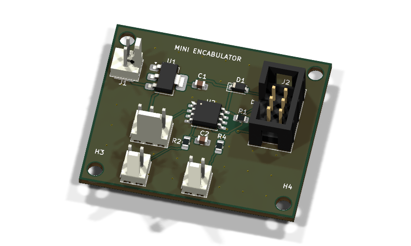
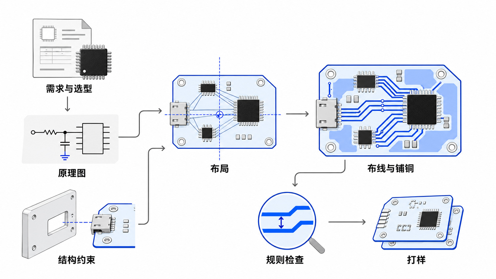

<h1 align="center"> Roadbook AI4PCB</h1>

Roadbook AI4PCB 由 SIGVoid 的硬件工程师和研究员共同维护。我们想弄清楚，设计一块电路板时，哪些工作已经可以交给 AI。你可以在这里读到研究论文和工程师的设计笔记，也可以打开模型交回的板文件，看看它把哪些线接对了。最近，我们在测试大模型读电路图、摆元件和接线的能力，也在把工程师的设计步骤和检查结果整理成训练数据，让模型学习怎样设计和检查一块板。

<p align="center"><a href="README.md">English</a> · <strong>中文</strong> &nbsp; | &nbsp; <a href="https://sig-void.github.io/Roadbook-AI4PCB/zh/">浏览完整中文版 ↗</a></p>

[论文精选](#read-papers) · [模型实测与答卷](#read-benchmarks) · [复跑 Harbor](#read-harbor) · [数据与权重](#read-data) · [PCB 工程笔记](#read-boards) · [参与合作](#read-contribute)

<a name="read-papers"></a>

## AI 怎样参与 PCB 设计？

一张原理图规定哪些引脚应该相连。布局决定元件放在哪里，布线决定铜线怎样把焊盘接起来。这些论文在不同阶段交付不同的结果。

| 工程问题 | 论文与项目 | 可以检查什么 |
| --- | --- | --- |
| 能从图上认出器件之间的连接吗？ | [OmniSch · 论文](https://arxiv.org/abs/2604.00270) · [样例与数据](https://www.omnisch.com/) | 从原理图中找器件和连线，再和记录引脚连接的网表对照。 |
| 能按需求画出可编辑的原理图吗？ | [SchGen · 论文](https://arxiv.org/abs/2605.30345) · [代码与示例](https://github.com/microsoft/SchGen) | 跟着 3.3 V 稳压电源的例子，从文字需求走到 KiCad 原理图，检查电源引脚。 |
| 元件摆好后，线还走得通吗？ | [RL_PCB · 论文](https://past.date-conference.com/proceedings-archive/2024/DATA/1040_pdf_upload.pdf) · [实验电路](https://github.com/LukeVassallo/RL_PCB) | 模型移动元件，再把候选布局交给布线器，用实际走线长度比较布局。 |
| 智能体能完成板级布线吗？ | [PCBWorld · 环境](https://github.com/LGAI-Research/PCBWorld) · [PCBRouteAgent · 论文](https://arxiv.org/abs/2611.08175) | 给定元件位置和需要接通的网络，模型选择走线顺序和换层位置。最终板文件可在 KiCad 中检查。 |
| 布线动作能拿来训练吗？ | [CADET · 论文](https://arxiv.org/abs/2611.16913) · [生成与回放代码](https://github.com/LGAI-Research/CADET) | 生成示范走线，在新环境中回放动作，再比较模仿学习和强化学习策略。 |

[按设计阶段查看全部论文 →](https://sig-void.github.io/Roadbook-AI4PCB/zh/research/papers/)

<a name="read-benchmarks"></a>

## 模型实测与答卷

**Agents’ Last Exam（ALE）** 有两道 KiCad 工程题。整板题给出原理图，要求按指定外壳的尺寸设计板框、摆放元件并完成布线。修复题给出一份已有设计，要求恢复导航开关板上 U4 的封装，并导出生产文件。

SIGVoid 在 ALE v1.1 的 Windows 环境中让两个模型各做两题，每题各跑一次。每题满分为 1。表中 ZIP 包含模型答卷、逐步操作记录和评分结果。

| 模型与推理强度 | 整板布局布线 | 导航开关修复 |
| --- | --- | --- |
| DeepSeek V4.1 Flash · max | **1** · [下载答卷与轨迹](https://sig-void.github.io/Roadbook-AI4PCB/assets/runs/ale-mini-deepseek.zip) | **0** · [下载答卷与轨迹](https://sig-void.github.io/Roadbook-AI4PCB/assets/runs/ale-navswitch-deepseek.zip) |
| Qwen4-Max-Preview · xhigh | **0** · [下载答卷与轨迹](https://sig-void.github.io/Roadbook-AI4PCB/assets/runs/ale-mini-qwen4.zip) | **0** · [下载答卷与轨迹](https://sig-void.github.io/Roadbook-AI4PCB/assets/runs/ale-navswitch-qwen4.zip) |

<p align="center"><a href="assets/harbor/ale-mini-encabulator/solution/sample/mini_encabulator.kicad_pcb"></a><br><sub>DeepSeek 整板题答卷。图像由 KiCad 从提交的板文件渲染。点击可查看原文件。</sub></p>

为什么修复题两份答卷都得了 0 分？两个模型都修好了 U4。DeepSeek 缺少指定格式的报告和网表，Qwen 的导出文件有命名和目录问题。评分器先查必交文件，这项检查决定了两份答卷的分数。[查看交付清单与逐项结果](https://sig-void.github.io/Roadbook-AI4PCB/zh/research/benchmarks/#ale-navswitch)

**另外两项评测考什么？**

- **OmniLayout 考元件布局。** 模型提交元件的坐标、朝向和板面，评测器检查重叠和越界，再尝试布线。GPT-5.5 的一次提交端到端通过率为 15.23%，增加原理图输入后为 42.83%。[论文表 2](https://arxiv.org/html/2607.03261v3#S5.T2)
- **BenchCAD T6 考从板图恢复接线。** 模型可用离线 Python 放大板图，答卷列出器件端子及其所属网络。2.0 Core 的 T6 有 12 块板。按修正规则，GPT-6 Astra 均分为 0.4222，Claude Opus 5.5 为 0.3983。SIGVoid 另测了 9 道 Public 练习题。[官方分项与评分说明](https://sig-void.github.io/Roadbook-AI4PCB/zh/research/benchmarks/#benchcad-t6) · [逐题操作轨迹 CSV](https://sig-void.github.io/Roadbook-AI4PCB/assets/runs/benchcad-public-t6-traces.csv) · [五批成绩 CSV](https://sig-void.github.io/Roadbook-AI4PCB/assets/runs/benchcad-public-t6.csv)

<a name="read-harbor"></a>

## 在 Harbor 里给一块板评分

仓库把 ALE 整板题的原理图、示例答卷和原题评分程序放在同一套题包里。可以直接打开[题面](assets/harbor/ale-mini-encabulator/instruction.md)、[起始原理图](assets/harbor/ale-mini-encabulator/environment/input/mini_encabulator.kicad_sch)和[示例板文件](assets/harbor/ale-mini-encabulator/solution/sample/mini_encabulator.kicad_pcb)。

安装 Harbor 0.25.0，启动支持 Linux AMD64 容器的 Docker。在仓库根目录依次运行以下命令。

```sh
harbor run -p ./assets/harbor/ale-mini-encabulator -a oracle
harbor run -p ./assets/harbor/ale-mini-encabulator -a nop
```

第一条命令重放已提交的示例板，预期得 **1 分**。第二条提交空目录，预期得 **0 分**。每次运行后，打开该次运行的 `verifier/checks.json` 查看各项检查，打开 `verifier/reward.txt` 查看得分。[浏览题包文件](https://sig-void.github.io/Roadbook-AI4PCB/zh/research/harbor-examples/) · [运行说明](assets/harbor/ale-mini-encabulator/README.md)

<a name="read-data"></a>

## 数据、模型与复现实验

- **需要原始板文件。** PCBench 的降压板样本同时提供原板、清理后的板和布线 JSON。先在原板上选一个焊盘，再核对 JSON 记录的网络和走线。[样本目录](https://github.com/PCBench/PCBench/tree/dec3be75cbdef74787625f9043c7391cd473bb64/PCBs/C-BISCUIT_buck-reg-5v) · [怎样判断原始板数据的质量](https://sig-void.github.io/Roadbook-AI4PCB/zh/research/datasets/procurement/)
- **需要可下载的模型。** SchGen 发布了生成原理图的适配器。Micius-Flash 提供工程多模态模型权重和 KiCad 案例。CADET 提供从布线示范学习的策略及强化学习微调后的策略。[SchGen 适配器](https://huggingface.co/microsoft/SchGen) · [Micius-Flash 权重](https://huggingface.co/zhiman-ai/Micius-Flash) · [CADET 权重](https://huggingface.co/LG-AI-Research/CADET)
- **想先在 CPU 上跑一个实验。** 用 112 块参考板的面积拟合网络数，再对 29 块留出板预测。面积模型平均误差为每块 5.72 条网络，固定猜训练集中位数的平均误差为 6.00 条。页面提供原始数据、Python 脚本和预期输出。[复现实验](https://sig-void.github.io/Roadbook-AI4PCB/zh/research/training/)

[浏览全部数据集](https://sig-void.github.io/Roadbook-AI4PCB/zh/research/datasets/) · [模型与权重](https://sig-void.github.io/Roadbook-AI4PCB/zh/research/models/) · [KiCad 智能体与插件](https://sig-void.github.io/Roadbook-AI4PCB/zh/research/agents/)

<a name="read-boards"></a>

## 从原理图到可以投板的文件

<p align="center"><a href="https://sig-void.github.io/Roadbook-AI4PCB/zh/workflow/"></a></p>

第一次画板，可以从 SIGVoid 硬件工程师的[PCB 绘制笔记](https://sig-void.github.io/Roadbook-AI4PCB/zh/workflow/)开始。手上已有工程，可以在[工具与环境](https://sig-void.github.io/Roadbook-AI4PCB/zh/design/tools/)查文件格式和导出方法，用[投板前的设计审查](https://sig-void.github.io/Roadbook-AI4PCB/zh/design/review/)核对封装、钻孔和装配文件。

| 在工程里遇到的问题 | 用什么证据判断 |
| --- | --- |
| [规则检查通过了，安装孔对得上外壳吗？](https://sig-void.github.io/Roadbook-AI4PCB/zh/blog/design-checks/) | 打开两份钻孔文件，比较孔心坐标。把一个孔移动 1 mm 后，孔距从 30 mm 变为 29 mm，两次规则检查都通过。 |
| [同一个电容的贴片坐标为什么一正一负？](https://sig-void.github.io/Roadbook-AI4PCB/zh/blog/assembly-origin/) | 在同一块 Cynthion 板上分别改变坐标原点和底面镜像设置，用一个顶面元件作对照。 |
| [原理图上属于同一个网络，板上的铜线接通了吗？](https://sig-void.github.io/Roadbook-AI4PCB/zh/blog/rp2040-power/) | 在 RP2040 板文件的副本里删掉一段铜线。焊盘仍显示同一个网名，KiCad 却能指出断点。 |
| [怎样查电压读数偏差？](https://sig-void.github.io/Roadbook-AI4PCB/zh/blog/revision-task/) | 对照 Glasgow 的扫频记录和改版电路，查看工程师为什么更换串联电阻、加装输入电容。 |
| [平均接通了 94.9%，有几块板整板通过？](https://sig-void.github.io/Roadbook-AI4PCB/zh/blog/routing-scores/) | 在同一组 10 块板上，4 块满足全部连通且错误级违规为零。可以沿论文表格复算两种分数。 |
| [同一款板改了版，能作为独立测试样本吗？](https://sig-void.github.io/Roadbook-AI4PCB/zh/blog/board-family-split/) | OLIMEX 的两份板文件相差一个电阻，导出的 142 行贴片坐标完全相同。比较改动的元件和实际用来评分的字段。 |

[获取公开板卡工程](https://sig-void.github.io/Roadbook-AI4PCB/zh/design/boards/) · [阅读全部工程笔记](https://sig-void.github.io/Roadbook-AI4PCB/zh/blog/)

<a name="read-contribute"></a>

## 参与贡献与合作

欢迎提交 PCB 论文、可编辑的设计文件、数据集或可运行的环境。附上原始链接，说明读者可以打开哪个文件、验证什么结果。[提交 Pull Request](https://github.com/SIG-Void/Roadbook-AI4PCB/compare) · [提出建议](https://github.com/SIG-Void/Roadbook-AI4PCB/issues) · [查看贡献者](https://github.com/SIG-Void/Roadbook-AI4PCB/graphs/contributors)

欢迎 PCB 专家一起制定评测标准、复核模型答卷。硬件团队和模型团队也可以联系 SIGVoid，共同研究提高大模型 PCB 能力的方法，或定制训练数据。[合作方向与联系方式](https://sig-void.github.io/Roadbook-AI4PCB/zh/about/#collaborate)

<details>
<summary>本地预览与发布</summary>

使用 Python 3.11 或更新版本，在仓库目录运行以下命令。

```sh
python3 -m venv .venv
.venv/bin/python -m pip install -r requirements.txt
.venv/bin/python scripts/build.py
.venv/bin/python scripts/check_site.py
.venv/bin/python -m http.server 8765 --bind 127.0.0.1 --directory dist
```

打开[中文首页](http://127.0.0.1:8765/zh/)。中英文正文在 [content](content/)。[scripts/build.py](scripts/build.py) 定义栏目、标题和路径。合入 `main` 后，GitHub Actions 会检查并发布网站。[主分支规则](https://github.com/SIG-Void/Roadbook-AI4PCB/rules/28038854) · [部署记录](https://github.com/SIG-Void/Roadbook-AI4PCB/actions/workflows/pages.yml)

</details>

<details>
<summary>资料与设计来源</summary>

目录版式参考 [Awesome AI4Chip](https://github.com/tapeo-ai/awesome-ai4chip)。部分论文和插件线索来自 whut09 的[工程智能体清单](https://github.com/whut09/Awesome-AI-Engineering-Agents/blob/main/README_CN.md)。清单采用 [MIT 许可](https://github.com/whut09/Awesome-AI-Engineering-Agents/blob/main/LICENSE)，各项目采用各自的许可。网站使用 [IBM Carbon 色板](https://carbondesignsystem.com/elements/color/overview/)，[字体许可](assets/fonts/)随仓库提供。

</details>
