An assembler uses a placement file to position components on a board. The X coordinate for the same capacitor is positive in one file and negative in another. Should you move the capacitor or change an export setting? Compare one top component and one bottom component in both files.

<h2 id="give-the-experiment-a-datum">What point does a placement file locate?</h2>

The Cynthion board from Great Scott Gadgets has components on both sides. C1 is a capacitor on the bottom. U1 is a chip on the top. Each row in the placement file identifies a component by its reference, `Ref`. The `Side` column identifies its board side. The `Rot` column gives its exported rotation. [Original Cynthion board](https://github.com/greatscottgadgets/cynthion-hardware/blob/babfb2332e1cb94ea850381e27483d200ad8a1c9/cynthion.kicad_pcb)

Two points determine `PosX` and `PosY`. The **origin** is the point on the drawing assigned the coordinates (0, 0). The **footprint anchor** is the point KiCad uses to locate a component. The coordinates describe the distance and direction from the origin to the anchor. Moving the origin changes the coordinates across the file. The pads stay in place on the board.

<h2 id="export-the-same-components-three-times">Did the origin move, or did the bottom view change?</h2>

We exported the same layout three times with KiCad 10.0.7. Each CSV contains both sides in millimeters. The first file uses the original board origin. For the second file, we set the drill and placement origin to (100, 120) mm on a copy. For the third file, we also enabled bottom-side X negation. This origin was selected for the comparison.

| Export setting | C1 · bottom · 0° | U1 · top · −90° |
| --- | --- | --- |
| Original board origin | (125.1, −84.7) mm | (133.7, −111.1) mm |
| Moved origin | (25.1, 35.3) mm | (33.7, 8.9) mm |
| Moved origin and negated bottom X | (−25.1, 35.3) mm | (33.7, 8.9) mm |

**Compare the first two rows.** Both parts shift by −100 mm in X and +120 mm in Y. Y increases downward in the board file and upward in this export. The board file places the C1 anchor at (125.1, 84.7) mm. From the new origin, travel 25.1 mm right and 35.3 mm up to reach it.

**Compare the last two rows.** Bottom capacitor C1 changes from X = +25.1 to −25.1 mm. Its Y and rotation stay the same. The row for U1 on the top stays the same. A change to this export setting produces both sets of coordinates for the same layout.



## What should you check in the assembly preview?

- **Both sides show the same shift.** Check the units and the origins used for the placement file and the board outline. Export again from the same board revision. Check a part near the edge against the outline in the preview.
- **The top aligns, but the bottom looks reversed.** Check whether the preview looks through the board from above or shows the board turned over. Compare the bottom X convention with the assembler's instructions. Moving one capacitor would leave the same discrepancy on other bottom components.
- **A chip is in position but appears rotated.** Find pad 1 on U1 in the layout. With the original board upright and viewed from above, pad 1 is above and right of the chip center. Check the pin 1 mark against that pad in the assembly preview. For a mismatch, check the assembler's zero-angle convention and the rotation assigned to this package. [Assembler's placement file example](https://jlcpcb.com/help/article/how-to-generate-the-bom-and-centroid-file-from-kicad)

<h2 id="check-all-282-rows-by-reference">Repeat the exports and check all 282 components</h2>

Use Python 3 and the KiCad command-line tool, `kicad-cli`. Run the following commands in an empty directory. They download a fixed board revision and set the origin on a copy. [KiCad position file command](https://docs.kicad.org/10.0/en/cli/cli.html#pcb_export_position_file)

```sh
curl -fL -o cynthion.kicad_pcb \
  https://raw.githubusercontent.com/greatscottgadgets/cynthion-hardware/babfb2332e1cb94ea850381e27483d200ad8a1c9/cynthion.kicad_pcb
python3 - <<'PYTHON'
from pathlib import Path
board = Path("cynthion.kicad_pcb").read_text()
assert board.count("(setup\n") == 1 and "(aux_axis_origin" not in board
fixture = board.replace("(setup\n", "(setup\n    (aux_axis_origin 100 120)\n", 1)
Path("fixture.kicad_pcb").write_text(fixture)
PYTHON
```

Export the three CSV files. Find C1 and U1 by reference in each file. Compare those rows with the table before checking the whole board.

```sh
kicad-cli pcb export pos --format csv --units mm --side both \
  -o board.csv cynthion.kicad_pcb
kicad-cli pcb export pos --format csv --units mm --side both \
  --use-drill-file-origin -o fixture.csv fixture.kicad_pcb
kicad-cli pcb export pos --format csv --units mm --side both \
  --use-drill-file-origin --bottom-negate-x -o mirror.csv fixture.kicad_pcb
```

Save the following code as `check.py`. Run `python3 check.py` in the directory with the CSV files. Each reference must occur once in each file. All 282 components showed the same shift after the origin moved. The final export reversed X for 197 bottom components and preserved the positions of 85 top components.

```python
import csv
from decimal import Decimal


def read_positions(filename):
    with open(filename, newline="") as source:
        rows = list(csv.DictReader(source))
    positions = {row["Ref"]: row for row in rows}
    assert len(positions) == len(rows), filename
    return positions


board = read_positions("board.csv")
fixture = read_positions("fixture.csv")
mirror = read_positions("mirror.csv")
assert board.keys() == fixture.keys() == mirror.keys()

for ref, original in board.items():
    shifted = fixture[ref]
    mirrored = mirror[ref]
    x = Decimal(shifted["PosX"])
    y = Decimal(shifted["PosY"])
    assert x == Decimal(original["PosX"]) - 100, ref
    assert y == Decimal(original["PosY"]) + 120, ref
    expected_x = -x if shifted["Side"] == "bottom" else x
    assert Decimal(mirrored["PosX"]) == expected_x, ref
    assert mirrored["PosY"] == shifted["PosY"], ref
    for field in ("Rot", "Side"):
        assert original[field] == shifted[field] == mirrored[field], (ref, field)

print(len(board), "placements checked")
```
