Suppose a placement test lists the component references from a new board revision. For each component, supply its X and Y coordinates, rotation, and board side from the reference design. How well would a copy of the old placement file score? On this development board, the copied file matches all 142 rows.

<h2 id="count-files-and-identify-the-family">How many products do 16 board files represent?</h2>

Here a board family contains the revisions of one product. The OLIMEX ESP32-PoE is a development board that can receive power through Ethernet. When an engineer changes the components or the routing, the project can retain the previous design. A single repository can hold releases and backup files for years. [Product and design files](https://github.com/OLIMEX/ESP32-POE/tree/deb38a377d50eadb04ddc7118a17a5ae58b1ee53)

The `HARDWARE` directory contains **16 board files in 15 revision directories for one product**. Revision E includes a backup. Git assigns a content identifier, called a blob ID, to each file. All 16 identifiers differ. A check for identical files would keep every one. A random file split could then put layouts from this product into both training and testing. [Hardware directory at the fixed revision](https://github.com/OLIMEX/ESP32-POE/tree/deb38a377d50eadb04ddc7118a17a5ae58b1ee53/HARDWARE)

<h2 id="compare-the-fields-the-model-must-predict">Check one component, then the complete placement file</h2>

Take revisions M1 and M2. Suppose the task gives a component reference and asks where to place it for assembly. Each row in the placement file identifies one component by its reference, such as `R1`. Compare its X and Y coordinates, rotation, and board side.

| Item checked with the same settings | M1 | M2 |
| --- | --- | --- |
| Footprints in the board file | 142 | 143 |
| Exported component rows, excluding the header | 142 | 142 |
| X and Y for resistor R1 (mm) | 91.440, −121.158 | 91.440, −121.158 |
| Rotation and side for R1 | 0°, bottom | 0°, bottom |

We exported both sides in millimeters with KiCad 10.0.7. All four fields matched for every one of the 142 shared references. The two CSV files were also identical byte for byte. The copied M1 file therefore scores **142/142** against the M2 reference. [M1 project](https://github.com/OLIMEX/ESP32-POE/tree/deb38a377d50eadb04ddc7118a17a5ae58b1ee53/HARDWARE/ESP32-PoE-hardware-revision-M1) · [M2 project](https://github.com/OLIMEX/ESP32-POE/tree/deb38a377d50eadb04ddc7118a17a5ae58b1ee53/HARDWARE/ESP32-PoE-hardware-revision-M2)



**Where is the extra footprint?** It belongs to resistor R23 on the bottom of M2. Search the M2 board file for `(fp_text reference "R23"`. Find the `attr` line in that footprint. Its `exclude_from_pos_files` attribute tells KiCad to omit the footprint from placement exports. You can find R23 in the board layout and confirm its absence from the CSV. [M2 board file](https://github.com/OLIMEX/ESP32-POE/blob/deb38a377d50eadb04ddc7118a17a5ae58b1ee53/HARDWARE/ESP32-PoE-hardware-revision-M2/ESP32-PoE_Rev_M2.kicad_pcb)

<h2 id="choose-the-split-for-the-intended-use">Does the test cover a new board or a revision?</h2>

| Engineering question | Prepare the data | Score the result |
| --- | --- | --- |
| Can the model recover the reference placements for a product it has never seen? | Give all 16 files one family ID. Keep that family in one group when you split the data. Test on products outside the training families. | Match predicted position, rotation, and side by reference. Record the number of independent test products and the revision for each. |
| Can the model identify a change from M1 to M2? | Supply both board revisions as inputs. Retain their original design files and the export settings. | Check whether the answer identifies the new R23 and explains its absence from the placement file using the footprint attribute. |

The first task scores an exact reference placement. If alternative layouts are acceptable, check component overlap, the board outline, and routing feasibility. The second task supplies the old board as an input and scores the changes found in the new board.

## Repeat the check with the public files

Use Git, Python 3, and the KiCad CLI. Start in a new directory. The fixed commit selects the revisions used above. Both exports use the same units and board sides. [KiCad placement export options](https://docs.kicad.org/10.0/en/cli/cli.html#pcb_export_position_file)

```sh
git clone --filter=blob:none --no-checkout https://github.com/OLIMEX/ESP32-POE.git
cd ESP32-POE
rev=deb38a377d50eadb04ddc7118a17a5ae58b1ee53
git ls-tree -r "$rev" HARDWARE > tree.txt
git restore --source="$rev" --worktree -- ':(glob)HARDWARE/*-M[12]/*.kicad_pcb'
for board_rev in M1 M2; do
  board="HARDWARE/ESP32-PoE-hardware-revision-${board_rev}/ESP32-PoE_Rev_${board_rev}.kicad_pcb"
  kicad-cli pcb export pos --format csv --units mm --side both -o "$board_rev.csv" "$board"
done
cmp M1.csv M2.csv
```

Here `cmp` prints nothing and exits with status 0, which confirms the files match byte for byte.

Run the next block in the same directory. Expect `16 16 15` for board files, distinct file contents, and revision directories. Expect `142 142 142 0` for M1 rows, M2 rows, shared references, and shared references with different fields.

```sh
python3 - <<'PY'
import csv
from pathlib import Path

entries = []
for line in Path("tree.txt").read_text().splitlines():
    metadata, path = line.split("\t", 1)
    if path.endswith(".kicad_pcb"):
        entries.append((metadata.split()[2], Path(path).parts[1]))
print(len(entries), len({item[0] for item in entries}), len({item[1] for item in entries}))

def positions(filename):
    with open(filename, newline="") as stream:
        rows = list(csv.DictReader(stream))
    fields = ("PosX", "PosY", "Rot", "Side")
    result = {row["Ref"]: tuple(row[field] for field in fields) for row in rows}
    assert len(result) == len(rows), "Duplicate component reference"
    return result

m1, m2 = positions("M1.csv"), positions("M2.csv")
common = m1.keys() & m2.keys()
print(len(m1), len(m2), len(common), sum(m1[ref] != m2[ref] for ref in common))
PY
```

If the row counts differ, identify the references that occur in only one file. Check the selected board sides and the export attribute on each missing footprint. If all positions differ by the same offset, check the export origin. Repeat with matching settings before you measure a component change in the layout. [Placement coordinates and their origin](assembly-origin.md)
