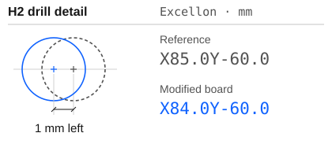

Both mounting screws must line up with the holes in the board. How can you check their positions when KiCad reports zero violations? Read the spacing on the enclosure drawing. Measure it on the board layout and again in the drill file for the fabricator.

<h2 id="start-with-the-enclosure-dimension">Measure between the hole centers on the layout</h2>

Suppose the enclosure drawing specifies **30 mm** between the screw centers. This example board has two mounting holes, H1 and H2. A copper track connects two test pads, TP1 and TP2. The modified layout moves only the right hole, H2, by 1 mm to the left. [Original board](../../assets/examples/hole-spacing/reference.kicad_pcb) · [Board with H2 moved](../../assets/examples/hole-spacing/shifted.kicad_pcb)

1. Open the original board in the KiCad PCB Editor. Find H1 on the left and H2 on the right.
2. Select the H1 footprint. Open its properties and read its X and Y coordinates. Repeat for H2. Here each footprint defines one hole, with its origin at the hole center. H1 is at (55, 60) mm and H2 is at (85, 60) mm.
3. Subtract the X coordinates because both holes have the same Y coordinate. The original spacing is 85 − 55 = **30 mm**. Open the modified board. H2 is now at X = 84 mm, giving a spacing of **29 mm**.



Measure from **center to center**. A cursor snapped to a hole edge measures a different distance. For an offset hole, use the actual hole center. For holes at different X and Y coordinates, use the measurement tool to find the distance between their centers.

## Why does the board still pass with a misplaced hole?

A design rule check (DRC) tests the board against the active rules. For example, KiCad can find a missing copper connection between two pads. This example has no schematic and its rules contain no requirement for the 30 mm spacing. Two changes show which result responds to a hole and which responds to a track.

| Board checked with KiCad 10.0.7 | Unconnected items | Hole spacing |
| --- | ---: | ---: |
| Original board | 0 | 30 mm |
| Move H2 only | 0 | 29 mm |
| Keep both holes and remove the track between TP1 and TP2 | 1 | 30 mm |

All three reports have an empty `violations` list. The third report identifies pad 1 on TP1 and TP2 in a separate field, `unconnected_items`. To repeat the third check, open a copy of the original board. Delete the short track between the test pads. Run the Design Rules Checker and open the Unconnected Items tab. [Original report](../../assets/examples/hole-spacing/reference.json) · [Report after moving H2](../../assets/examples/hole-spacing/shifted.json) · [KiCad DRC command](https://docs.kicad.org/10.0/en/cli/cli.html#pcb_drc)

<h2 id="where-will-the-drill-hit-h2">Where will the fabricator drill the holes?</h2>

The drill file specifies the tool diameter and hole positions. These mounting holes have no plated walls. KiCad puts them in a file with `NPTH` in its name. Open each file in a text editor. [Original drill file](../../assets/examples/hole-spacing/reference-NPTH.drl) · [Drill file after moving H2](../../assets/examples/hole-spacing/shifted-NPTH.drl)

In the header, `METRIC` selects millimeters and `T1C3.200` specifies a 3.2 mm diameter for tool 1. Find the line containing only `T1`. The next two lines give the hole centers.

In both files, H1 is at `X55.0Y-60.0`. H2 is at `X85.0Y-60.0` on the original and `X84.0Y-60.0` on the modified board. The export reverses the Y direction. Both holes still share a horizontal line.



Save both board files in one directory. Run these commands there. Read the hole centers in the two `*-NPTH.drl` files under `drill/`. [KiCad drill export](https://docs.kicad.org/10.0/en/cli/cli.html#pcb_export_drill_file)

```sh
kicad-cli pcb export drill --excellon-separate-th -o drill/ reference.kicad_pcb
kicad-cli pcb export drill --excellon-separate-th -o drill/ shifted.kicad_pcb
```

<h2 id="give-the-evaluator-two-separate-results">Which file needs a correction?</h2>

- **Both the layout and the drill file show 29 mm.** The layout already contains the error. Move H2 to the specified position and export the drill file again.
- **The layout shows 30 mm, but the production drill file shows 29 mm.** Check the board ID and revision. Export again from the board intended for production and measure the spacing. Keep both measurements to locate the discrepancy.
- **Both files show 30 mm.** The nominal spacing matches the requirement. For a physical fit, also check the hole position tolerances, hole diameters, and screw dimensions on the mechanical drawing.

An automated review can report both results for the modified board. Record “TP1 and TP2 connected” alongside “required spacing 30 mm, measured 29 mm.” The reader can identify which hole needs attention.
