How accurately can a chip read a DC voltage with ripple on it? On a Glasgow interface board, an engineer held the reference voltage and ripple amplitude steady and changed the ripple frequency. At one frequency, the largest reading error reached 110 mV. That test helped locate the circuit to change. [Original measurements](https://github.com/GlasgowEmbedded/glasgow/issues/221#issuecomment-753531753)

<h2 id="why-the-sensing-circuit-changed">How does ripple affect a voltage reading?</h2>

Glasgow connects to digital devices for development and testing. Each of its two ports, A and B, has an INA233 chip that measures the port voltage. Software reads the value after the signal passes through the sense circuit and the chip. The engineer applied a known voltage at the port to test this path. [Glasgow project](https://glasgow-embedded.org/en/intro.html) · [INA233 pin functions](https://www.ti.com/lit/ds/symlink/ina233.pdf#page=3)

On the revC2 board, a calibrator supplied a steady DC reference. A generator added a triangle wave to represent ripple from a switching supply. The engineer used an oscilloscope to set the difference between the peaks and troughs to 200 mV. The generator then swept in 1 kHz steps while a program read the chip. The oscilloscope measured the applied ripple. Comparing the chip readings with the DC reference gave the measurement error. [Setup and sweep data](https://github.com/GlasgowEmbedded/glasgow/issues/221#issuecomment-753531753)

At 338 kHz, 1.014 MHz, and 1.353 MHz, the maximum deviations were 34, 110, and 43 mV, respectively. The hardware change attributes these peaks to **aliasing**. The chip takes samples at intervals. If those samples repeatedly land near the peak of a wave, the readings can run high even with a steady mean input. Narrow peaks could also fall between the 1 kHz steps. [Hardware change](https://github.com/GlasgowEmbedded/glasgow/commit/ccde65e792429e3f873e0dcdcc410eb95b17117a)

## How much did averaging inside the chip help?

| Test condition at 1.014 MHz | Standard deviation | Maximum deviation |
| --- | ---: | ---: |
| Original revC2 input circuit, averaging count unspecified | 63 mV | 110 mV |
| Same input circuit, INA233 set to average 64 samples | 26 mV | 50 mV |
| Input filter with 470 Ω and 1 nF, INA233 set to average four samples | 16 mV | 26 mV |

Standard deviation describes the spread of the readings. Maximum deviation gives the largest observed difference from the reference. With the original input circuit, setting the INA233 to average 64 samples reduced the maximum error from 110 mV to 50 mV. The third row changes both the input circuit and the averaging setting. The 26 mV result applies to that combination at this frequency. To measure the effect of the filter alone, compare the two circuits at the same averaging setting. [Test results](https://github.com/GlasgowEmbedded/glasgow/issues/221#issuecomment-753531753)

<h2 id="define-the-change-before-grading-it">Why 470 Ω and 1 nF?</h2>

The change affects the measurement branch. The port voltage reaches the VBUS measurement pin through a series resistor on the VSENSE line. A capacitor connects that pin to ground. The two parts form a low-pass filter that reduces high-frequency interference before sampling. The nominal time constant is 470 Ω × 1 nF = 0.47 µs, which gives a cutoff frequency of about 339 kHz. This calculation estimates the response of the input filter. The table gives errors measured at the chip output.

The engineer tried a 2.2 kΩ resistor. With the interference removed, the DC reading was still about 1% low. The capacitor had to fit the existing 0402 footprint and meet a 40 V rating requirement. The revC3 schematic specifies a 470 Ω resistor and a 1 nF, 50 V C0G ceramic capacitor. [Component selection](https://github.com/GlasgowEmbedded/glasgow/issues/221#issuecomment-753531753) · [Revised schematic](https://github.com/GlasgowEmbedded/glasgow/blob/ccde65e792429e3f873e0dcdcc410eb95b17117a/hardware/boards/glasgow/io_buffer.sch#L2448-L2498)

<h2 id="check-the-connections-then-consider-performance">How can you check both ports?</h2>

Open the board files from before and after the change. Find C91 in the PCB editor. Both files place its pads at the same position and angle. Its value changed from DNP to 1 nF, and the adjacent R60 changed from 4.7 Ω to 470 Ω. Port B uses the same schematic sheet with different component labels on the board. In the table, R60.2 means pad 2 of R60. [Original board](https://github.com/GlasgowEmbedded/glasgow/blob/f51a08c8a9c0b90aaa6094950dae01bfdf4ad4fa/hardware/boards/glasgow/glasgow.kicad_pcb) · [Revised board](https://github.com/GlasgowEmbedded/glasgow/blob/ccde65e792429e3f873e0dcdcc410eb95b17117a/hardware/boards/glasgow/glasgow.kicad_pcb)

| Port | Where the voltage enters | Pads connected after the resistor | Capacitor pad on ground |
| --- | --- | --- | --- |
| A | R60.2 | R60.1, C91.2, U21.8 | C91.1 |
| B | R59.2 | R59.1, C90.2, U12.8 | C90.1 |

Use Highlight Net on pad 2 of C91. Pad 1 of R60 and pin 8 of U21 should light up. If ground copper lights up, check the pad number. Pad 1 of C91 connects to ground. Repeat the check on pad 2 of C90 using the row for port B. On a physical board, also check the assembly record and the parts fitted at both capacitor positions.
