An automatic router returns ten boards and reports 94.9% average connection completion. Which boards still need work? For each board, check the missing connections and the design rule errors. In the PCBRouteAgent experiment with Claude Opus 5.5, four boards had all connections and zero errors. [Table 4](https://arxiv.org/html/2611.08175v2#S5.T4)

<h2 id="follow-the-last-connection">How can two boards give three percentages?</h2>

A pad is the copper contact for a component pin. A netlist identifies the pads that should connect. KiCad displays thin lines between pads that still need a connection. PCBWorld counts these lines before and after routing. The difference gives the number of completed connections. One completed connection can contain several copper segments. [Metric definitions](https://arxiv.org/html/2607.05915v4#A9)

**Consider two example boards.** The small board completes 9 of 10 connections. The large board completes all 90. Neither board has an error-level violation.

| Question | Calculation | Result |
| --- | --- | ---: |
| How much did the average board complete? | Average the individual board results, 90% and 100%. | 95% |
| How much of the total connection work is complete? | (9 + 90) / (10 + 90) | 99% |
| How many boards passed? | The large board passed. The small board still needs one connection. One of two boards passed. | 50% |

In Table 4, find the Opus row for D3-C, the large two-layer boards. The average completion rate (`Rout.`) is 0.949. The clean-pass rate (`CP`) is 0.400. Multiply the latter by ten to get four boards. A board can reach 100% connection completion and still fail if its copper violates a clearance rule. [Table 4](https://arxiv.org/html/2611.08175v2#S5.T4)

The Haiku 5.5 results show how weighting changes the answer. With PCBRouteAgent, the average across these ten boards was 91.5%. One board passed. Table 7 adds up the connections across boards and reports 1,080 of 1,178, or 91.7%. Boards with more connections carry more weight in that calculation. [Board averages and clean passes](https://arxiv.org/html/2611.08175v2#S5.T4) · [Connection totals](https://arxiv.org/html/2611.08175v2#A3.T7)

<h2 id="what-stopped-the-last-connections">Where did a failed board run out of space?</h2>

On one large board, Haiku with PCBRouteAgent completed 84 of 86 connections. Haiku with the PCBWorld baseline completed 10 of 86. Both boards failed. The first needed two more connections. The second needed 76. The counts show how much work remains. [Two outputs for the same board](https://arxiv.org/html/2611.08175v2#A4.SS1)

Figure 5 shows where two signals got stuck on another board. The reference design completed all 83 connections. Opus completed 70. [Figure 5 and routing sequence](https://arxiv.org/html/2611.08175v2#A4.SS2)

1. **Find the endpoints.** The controller supplies the sensor clock on SCL and exchanges data on SDA. Locate the signal pins at both devices.
2. **Follow the copper.** Space was tight near the controller pads. The model used vias to change layers and reach open space. The dashed lines in the figure show paths proposed for a retry. Trace the copper that the router actually placed.
3. **Check the earlier decision.** A power trace placed first blocked the signal paths near the sensor. The repair step removed the unfinished attempts and kept the power trace. The reference used different paths and layers for the two signals.

A fully connected board can also require review. Another output completed all 55 connections. The USB data signals D+ and D− operate as a pair. Both reference traces ran together for 30.25 mm. The model routed them independently at 34.03 mm and 36.49 mm, a difference of 2.46 mm. The planning input specified individual widths and clearances but omitted the pair relationship. Reliable USB operation still requires electrical validation. [USB trace comparison](https://arxiv.org/html/2611.08175v2#A4.SS3)

<h2 id="check-which-boards-enter-the-denominator">Do two D3-B results cover the same boards?</h2>

D3-B is the PCBWorld group for medium boards. PCBRouteAgent used ten two-layer boards, one from each pad-count range. Opus passed all ten. The authors retried failed model responses and repaired trace angles. Each board contributed one final file. [Ten-board list, Table 28](https://arxiv.org/html/2607.05915v4#A15.T28) · [Experimental setup](https://arxiv.org/html/2611.08175v2#S4)

CADET used 141 boards for testing and 142 reference boards to characterize the training boards. We matched the directory names of the ten boards against both lists. **Six boards** occur in the test list. Their IDs start with `0113`, `0174`, `0232`, `0288`, `0316`, and `0344`. The other four occur in the reference list. For example, search for `0174_sensorboard_DiffIR` in Table 28 and the test list. [Test list](https://github.com/LGAI-Research/CADET/blob/7bea0d51d3ee96bacf2915fd0d3e119fa4404cc5/cadet/configs/splits/boards_d3b_test.txt) · [Reference list](https://github.com/LGAI-Research/CADET/blob/7bea0d51d3ee96bacf2915fd0d3e119fa4404cc5/cadet/configs/splits/boards_d3b_fit.txt)

For a direct comparison, run both methods on those six boards with identical input files, rules, and time limits. Compare the missing connections and errors for each board. CADET’s published 67.2% averages repeated experiments across four training seeds. Individual board outcomes require the records for the run in question. [CADET setup](https://arxiv.org/html/2611.16913v1#S4.SS1)

<h2 id="check-the-attempts-and-the-clock">How much time did two extra attempts cost?</h2>

| 141 D3-B test boards | Mean clean-pass rate | Mean time per board |
| --- | ---: | ---: |
| CADET, one attempt | 67.2% | 15.5 s |
| CADET, best of three | 79.8% | 47.6 s |
| Freerouting, one attempt | 65.6% | 45.6 s |

Both settings submit one final result per board. The `@1` setting allows one attempt. The `@3` setting allows three attempts and selects one result. On the same server, the best of three CADET attempts cost an extra 32.1 seconds per board on average. The mean clean-pass rate rose by 12.6 percentage points. The authors selected by clean pass first and broke ties by the gain in routing score. [CADET, Table 2](https://arxiv.org/html/2611.16913v1#S4.T2)

Check what each paper includes in its time column. PCBWorld gives stochastic methods five attempts in its main table and selects one result by score gain. The time column reports the mean duration of one attempt. Use the single-attempt table when the router can run only once per board. [Selection and timing](https://arxiv.org/html/2607.05915v4#S4.SS3) · [Single-attempt results, Table 22](https://arxiv.org/html/2607.05915v4#A12.T22)
