Two pins share a power connection on a schematic. How can you tell if a copper trace to one pin is missing from the board layout? The minimal RP2040 board from Raspberry Pi has a supply that runs to two pins on the chip. Its public KiCad project lets you trace that supply and test a break on a copy. [Download the official R3-S1 project](https://pip.raspberrypi.com/documents/RP-008296-DS)

<h2 id="follow-the-regulator-output-to-the-core">Find the power path on the schematic</h2>

Extract the R3-S1 archive. Open the `.kicad_pro` project file in KiCad. Double-click the matching `.kicad_sch` schematic file. Find the RP2040 chip, labeled U3.

Its internal regulator reduces the input voltage to the voltage that the core uses. On this board, the regulator output leaves the chip. Copper on the board carries it back to two core supply pins. The same net name on the schematic identifies pins that should connect. [RP2040 hardware design guide, chapter 2](https://datasheets.raspberrypi.com/rp2040/hardware-design-with-rp2040.pdf)

| Pin on U3 | Name on the schematic | Role in the power path |
| --- | --- | --- |
| 44 | VREG_IN on `+3V3` | Receives 3.3 V from board regulator U1 to supply the internal regulator. |
| 45 | VREG_VOUT on `+1V1` | Supplies the 1.1 V output from the internal regulator. |
| 23 and 50 | DVDD on `+1V1` | Receive power for the digital core through the board copper. |

In the project window, double-click the matching `.kicad_pcb` board file. Find pad 45 of U3 and use Highlight Net. A pad is the copper area where a chip pin attaches to the board. Pads 23, 45, and 50 should light up together. The adjacent pad 44 belongs to a different supply. If the highlighted net is `+3V3`, check whether you selected pad 44.



The `+1V1` net also reaches pad 1 on each of three capacitors. C6 and C7 are 100 nF each, and C8 is 1 µF. Pad 2 on each capacitor connects to ground. The three chip pads and three capacitor pads account for six component pads. Count the four vias separately. These holes carry the connection between copper layers. [Board, schematic, and bill of materials](https://pip.raspberrypi.com/documents/RP-008296-DS)

## Which check finds an open trace?

1. Open the original board in the PCB Editor. Run the Design Rules Checker and open Unconnected Items. The original has zero entries.
2. Copy the entire project directory. Open the board copy and zoom in on pad 50 of U3. Find the front copper segment (`F.Cu`) that runs from the pad toward a via. In R3-S1, it is 0.2 mm wide. Its ends are at (99.8, 96.5625) mm and (99.8, 95.199994) mm.
3. Delete only that segment. Keep the pad and the via. Save the copy and use Highlight Net on pad 45 again. Pad 50 still carries the name `+1V1` because its net assignment has stayed the same.
4. Run the Design Rules Checker on the copy. Open Unconnected Items and double-click the new entry. The report identifies pad 50 of U3 and a back copper trace (`B.Cu`). The via joins the two layers. The gap lies on the branch where you removed the front copper segment.

| KiCad 10.0.7 check | Original board | Copy with one segment removed |
| --- | ---: | ---: |
| Component pads / vias on `+1V1` | 6 / 4 | 6 / 4 |
| Differences reported by the schematic parity check | 0 | 0 |
| Unconnected items on the board | 0 | 1 |

If the copy still has zero unconnected items, check the file path in the editor. Check that you deleted the segment next to pad 50. If other gaps appear, open each entry and check its endpoints and copper layers. Both reports also listed 34 footprint library warnings on our installation. Those warnings appear separately in the report. [KiCad board checks](https://docs.kicad.org/10.0/en/pcbnew/pcbnew.html)

<h2 id="export-the-schematic-and-the-board-separately">Read the schematic and the board from the command line</h2>

To compare several board revisions, save the check results for each revision. Run the commands below in an empty directory. They download R3-S1 and export two lists using KiCad CLI 10.0.7. The file `schematic.xml` gives the intended connections. The file `board.d356` gives the pad assignments from the board in the IPC-D-356 electrical test format. [KiCad CLI reference](https://docs.kicad.org/10.0/en/cli/cli.html)

```sh
curl -fL -o minimal.zip https://pip-assets.raspberrypi.com/categories/814-rp2040/documents/RP-008296-DS-2-Minimal-KiCAD.zip
unzip -q minimal.zip
cd RPI-RP2040-MINIMAL_R3-S1_public
board=RPI-RP2040-MINIMAL_R3-S1
kicad-cli sch export netlist --format kicadxml -o schematic.xml "$board.kicad_sch"
kicad-cli pcb export ipcd356 -o board.d356 "$board.kicad_pcb"
```

<h2 id="compare-the-six-pads">Identify a missing or extra pad</h2>

Save this code as `check_pads.py` in the directory containing `schematic.xml` and `board.d356`. The expected list comes from the R3-S1 schematic. For this board, IPC-D-356 record type `327` identifies a surface-mount pad. Type `317` with the `VIA` label identifies a via.

```python
import re
from pathlib import Path
from xml.etree import ElementTree

expected = {"U3.23", "U3.45", "U3.50", "C6.1", "C7.1", "C8.1"}
root = ElementTree.parse("schematic.xml")
nodes = root.findall(".//nets/net[@name='+1V1']/node")
schematic_pads = {f"{n.get('ref')}.{n.get('pin')}" for n in nodes}

board_pads = set()
via_count = 0
for line in Path("board.d356").read_text().splitlines():
    match = re.match(r"^327\+1V1\s+(\w+)\s+-(\d+)\s", line)
    if match:
        board_pads.add(f"{match[1]}.{match[2]}")
    if line.startswith("317+1V1 ") and " VIA " in line:
        via_count += 1

for source, pads in (("schematic", schematic_pads), ("board", board_pads)):
    print(source, "missing:", sorted(expected - pads), "extra:", sorted(pads - expected))
print("board vias:", via_count)
```

In a terminal, run `python3 check_pads.py` from that directory. For the original board, both results should show empty `missing` and `extra` lists. The `board vias` count should be 4. If only the board list shows `U3.50` as missing, inspect the net assigned to that pad. Check that the schematic and layout came from the same revision. When both lists agree, check the copper path for gaps.

Run the following commands in each project directory. The `--schematic-parity` option also checks the board against the schematic. Expect `unconnected: 0 schematic parity: 0` on the original and `unconnected: 1 schematic parity: 0` on the copy. This result locates a gap in the design files. Checking whether the assembled board maintains 1.1 V under load requires a voltage measurement.

```sh
board=RPI-RP2040-MINIMAL_R3-S1
kicad-cli pcb drc --schematic-parity --severity-all --format json -o drc.json "$board.kicad_pcb"
python3 -c 'import json; r=json.load(open("drc.json")); print("unconnected:", len(r["unconnected_items"]), "schematic parity:", len(r["schematic_parity"]))'
```
