装配厂把元件贴在板上，要用一张坐标表。表里同一只电容的 X 坐标，一次是正数，一次是负数。该改板图，还是该改导出设置？选一个顶面元件和一个底面元件，在两份表里找到它们，比较各自的坐标变化。

<h2 id="先给这次实验一个原点">贴片坐标表里的一个位置指哪里？</h2>

Great Scott Gadgets 的 Cynthion 板正反两面都装有元件。底面有一只编号为 C1 的电容，顶面有一颗编号为 U1 的芯片。贴片坐标表也叫位置文件。每个元件占一行，`Ref` 是元件在板图上的编号，`Side` 是顶面或底面，`Rot` 是导出的旋转角。[Cynthion 原始板文件](https://github.com/greatscottgadgets/cynthion-hardware/blob/babfb2332e1cb94ea850381e27483d200ad8a1c9/cynthion.kicad_pcb)

读 `PosX`、`PosY` 时要知道两个点。**原点**是板图上约定为 (0, 0) 的位置。**封装锚点**是 KiCad 用来定位这个元件的点。坐标描述从原点走到锚点的距离和方向。原点移了，整张表的读数都会变，板上的焊盘仍在原处。

<h2 id="对同一组元件导出三次">怎样分清原点移动和底面镜像？</h2>

用 KiCad 10.0.7 对同一套布局导出三份表，每份都含两面，单位都是毫米。先用原板默认原点。然后在副本中把钻孔与贴片原点设在板图坐标 (100, 120) mm。最后保持这个原点，打开“底面 X 取反”选项。本例中的原点专供比较使用。

| 导出设置 | C1 · 底面 · 0° | U1 · 顶面 · −90° |
| --- | --- | --- |
| 原板默认原点 | (125.1, −84.7) mm | (133.7, −111.1) mm |
| 移动原点 | (25.1, 35.3) mm | (33.7, 8.9) mm |
| 移动原点，底面 X 取反 | (−25.1, 35.3) mm | (33.7, 8.9) mm |

**比较前两行。** C1 和 U1 的 X 都减少 100 mm，Y 都增加 120 mm。在板文件里，Y 向下增大；在这份贴片坐标表里，Y 向上增大。C1 的锚点在板图 (125.1, 84.7) mm。从新原点到 C1，要向右走 25.1 mm，向上走 35.3 mm。

**比较后两行。** 底面 C1 的 X 从 +25.1 变为 −25.1，Y 和旋转角保持相同。顶面 U1 的整行都相同。这正是该导出选项的作用。在这块板上只需改变导出设置，就能生成这两种读数。



## 装配预览有偏差，先查哪里？

- **上下两面的元件都偏了同一段距离。** 核对单位，再查坐标表和板框使用的原点。用同一版板图重导，并在预览中对照板框和靠近板边的元件。
- **顶面位置吻合，底面元件左右颠倒。** 先确认预览画面是从顶面看穿板子，还是把板翻过来看底面。按装配方的坐标约定核对底面 X 的符号。单独改一个电容的位置，会掩盖整面的差异。
- **位置吻合，但芯片方向可疑。** 在板图里找到 U1 的 1 号焊盘。按原板方向从顶面看，它在芯片中心的右上方。在装配预览里找到芯片的 1 脚标记，对照同一个焊盘。若方向不符，再查装配方规定的零度方向和该封装对应的旋转角。检查芯片的朝向时，有编号的引脚比对称电容更容易辨认。[装配方的坐标表示例](https://jlcpcb.com/help/article/how-to-generate-the-bom-and-centroid-file-from-kicad)

<h2 id="用位号检查全部-282-行">复做三次导出，核对全部 282 个元件</h2>

在空目录中运行下面的命令。需要 Python 3 和 KiCad 命令行工具 `kicad-cli`。第一步下载固定版本的板文件，再复制一份，只在副本中设置原点。[KiCad 坐标导出命令](https://docs.kicad.org/10.0/en/cli/cli.html#pcb_export_position_file)

```sh
curl -fL -o cynthion.kicad_pcb \
  https://raw.githubusercontent.com/greatscottgadgets/cynthion-hardware/babfb2332e1cb94ea850381e27483d200ad8a1c9/cynthion.kicad_pcb
python3 - <<'PYTHON'
from pathlib import Path
board = Path("cynthion.kicad_pcb").read_text()
assert board.count("(setup\n") == 1 and "(aux_axis_origin" not in board
fixture = board.replace("(setup\n", "(setup\n    (aux_axis_origin 100 120)\n", 1)
Path("fixture.kicad_pcb").write_text(fixture)
PYTHON
```

分别导出 `board.csv`、`fixture.csv` 和 `mirror.csv`。按 `Ref` 找到 C1 和 U1，先与上表逐项核对，再检查整块板。

```sh
kicad-cli pcb export pos --format csv --units mm --side both \
  -o board.csv cynthion.kicad_pcb
kicad-cli pcb export pos --format csv --units mm --side both \
  --use-drill-file-origin -o fixture.csv fixture.kicad_pcb
kicad-cli pcb export pos --format csv --units mm --side both \
  --use-drill-file-origin --bottom-negate-x -o mirror.csv fixture.kicad_pcb
```

把下面的代码保存为 `check.py`，在同一目录运行 `python3 check.py`。程序按位号配对。同一位号在每份表里只应出现一次。本次导出的 282 个元件都满足同一组平移关系。最后一次导出中，197 个底面元件的 X 值取反，85 个顶面元件的坐标保持相同。

```python
import csv
from decimal import Decimal


def read_positions(filename):
    with open(filename, newline="") as source:
        rows = list(csv.DictReader(source))
    positions = {row["Ref"]: row for row in rows}
    assert len(positions) == len(rows), filename
    return positions


board = read_positions("board.csv")
fixture = read_positions("fixture.csv")
mirror = read_positions("mirror.csv")
assert board.keys() == fixture.keys() == mirror.keys()

for ref, original in board.items():
    shifted = fixture[ref]
    mirrored = mirror[ref]
    x = Decimal(shifted["PosX"])
    y = Decimal(shifted["PosY"])
    assert x == Decimal(original["PosX"]) - 100, ref
    assert y == Decimal(original["PosY"]) + 120, ref
    expected_x = -x if shifted["Side"] == "bottom" else x
    assert Decimal(mirrored["PosX"]) == expected_x, ref
    assert mirrored["PosY"] == shifted["PosY"], ref
    for field in ("Rot", "Side"):
        assert original[field] == shifted[field] == mirrored[field], (ref, field)

print(len(board), "placements checked")
```
