假设要按元件编号还原新版板图的贴片坐标表。每行要填 X、Y 坐标、旋转角和安装面。把旧版坐标表原样交上去，能得多少分？我们用一款开发板的两个版本做了对照。旧表的 142 行全部答对。

<h2 id="先数文件-再数板族">16 份板文件，来自几款产品？</h2>

这里的“板族”指同一款产品历次改版留下的设计。OLIMEX 的 ESP32-PoE 是一款支持以太网供电的开发板。工程师修改器件或走线后，会保存一个新版本。早期版本和备份都可能与新版一起留在仓库里。[产品与原始工程](https://github.com/OLIMEX/ESP32-POE/tree/deb38a377d50eadb04ddc7118a17a5ae58b1ee53)

这个仓库的 `HARDWARE` 目录含 **16 份板文件、15 个改版目录、1 款产品**。多出来的文件是 E 版备份。Git 为 16 份文件算出的内容标识（blob ID）各不相同。如果只删除内容完全相同的文件，这 16 份都会留下。把它们随机分到两组，训练和测试就可能都包含同一款产品的布局。[固定版本的板文件目录](https://github.com/OLIMEX/ESP32-POE/tree/deb38a377d50eadb04ddc7118a17a5ae58b1ee53/HARDWARE)

<h2 id="比较模型真正要预测的字段">先对一个元件，再对整张坐标表</h2>

拿其中相邻的 M1 和 M2 两版来查。假设任务是给定元件编号，让模型填出装配位置。工厂用的贴片坐标表每行对应一个元件。行首的位号（如 `R1`）标识这块板上的元件。其余要核对的四列是 X 坐标、Y 坐标、旋转角度和安装面。

| 在同一设置下比较 | M1 | M2 |
| --- | --- | --- |
| 板文件中的封装数 | 142 | 143 |
| 导出的贴片坐标行数（不含表头） | 142 | 142 |
| 电阻 R1 的 X、Y（mm） | 91.440，−121.158 | 91.440，−121.158 |
| R1 的角度和安装面 | 0°，底面 | 0°，底面 |

这组坐标取自 KiCad 10.0.7 的双面导出，单位为毫米。用位号对齐后，两版 142 个共有元件的四列数值逐项相同，两份 CSV 连文件内容都相同。把 M1 的表交给 M2 的坐标题评分，照抄这份文件就能得到 **142/142**。[M1 工程](https://github.com/OLIMEX/ESP32-POE/tree/deb38a377d50eadb04ddc7118a17a5ae58b1ee53/HARDWARE/ESP32-PoE-hardware-revision-M1) · [M2 工程](https://github.com/OLIMEX/ESP32-POE/tree/deb38a377d50eadb04ddc7118a17a5ae58b1ee53/HARDWARE/ESP32-PoE-hardware-revision-M2)



**多出来的第 143 个封装去了哪里？** 它是 M2 底面的电阻 R23。在板文件里搜索 `(fp_text reference "R23"`，查看它所在封装的 `attr` 一行，其中有 `exclude_from_pos_files`。这个属性要求 KiCad 在导出贴片坐标时跳过该封装。在板图里能找到 R23，在坐标表里应查不到它。[M2 原始板文件](https://github.com/OLIMEX/ESP32-POE/blob/deb38a377d50eadb04ddc7118a17a5ae58b1ee53/HARDWARE/ESP32-PoE-hardware-revision-M2/ESP32-PoE_Rev_M2.kicad_pcb)

<h2 id="让划分对应实际使用场景">测试新板，还是检查一次改版？</h2>

| 工程师的问题 | 怎样准备样本 | 怎样评分 |
| --- | --- | --- |
| 模型能还原未见产品的参考贴片坐标吗？ | 给同一产品的 16 份文件同一个板族编号。划分训练、验证和测试集时，让一个板族只进入一组。测试另选独立产品。 | 按测试板的位号核对预测的位置、角度和板面。记录测试集含多少款产品，以及每款用了哪个版本。 |
| 模型能找出从 M1 到 M2 的变更吗？ | 把旧版 M1 和新版 M2 都作为题目输入。保留原始板文件、导出设置和对应版本。 | 检查模型是否找到新增的 R23，能否从封装属性解释坐标表为何少这一行。 |

第一种任务按参考坐标评分。如果允许元件摆在其他位置，应按器件是否重叠、是否超出板框、能否完成布线等约束评估布局。第二种任务把旧版作为已知资料，考的是能否识别新版的变更。

## 用公开文件复核

下面的命令需要 Git、Python 3 和能从终端运行的 KiCad CLI。在新目录中运行。固定提交可以保证拿到文中使用的两个版本。两次导出使用相同的单位和板面设置。[KiCad 坐标导出选项](https://docs.kicad.org/10.0/en/cli/cli.html#pcb_export_position_file)

```sh
git clone --filter=blob:none --no-checkout https://github.com/OLIMEX/ESP32-POE.git
cd ESP32-POE
rev=deb38a377d50eadb04ddc7118a17a5ae58b1ee53
git ls-tree -r "$rev" HARDWARE > tree.txt
git restore --source="$rev" --worktree -- ':(glob)HARDWARE/*-M[12]/*.kicad_pcb'
for board_rev in M1 M2; do
  board="HARDWARE/ESP32-PoE-hardware-revision-${board_rev}/ESP32-PoE_Rev_${board_rev}.kicad_pcb"
  kicad-cli pcb export pos --format csv --units mm --side both -o "$board_rev.csv" "$board"
done
cmp M1.csv M2.csv
```

本例中，`cmp` 成功退出（状态码 0），不输出文字，表示两个文件逐字节相同。

在同一目录中运行下段代码。第一行预期是 `16 16 15`，依次为板文件数、不同文件内容数、改版目录数。第二行预期是 `142 142 142 0`，依次为 M1 行数、M2 行数、共有位号数、共有位号中坐标等字段不同的行数。

```sh
python3 - <<'PY'
import csv
from pathlib import Path

entries = []
for line in Path("tree.txt").read_text().splitlines():
    metadata, path = line.split("\t", 1)
    if path.endswith(".kicad_pcb"):
        entries.append((metadata.split()[2], Path(path).parts[1]))
print(len(entries), len({item[0] for item in entries}), len({item[1] for item in entries}))

def positions(filename):
    with open(filename, newline="") as stream:
        rows = list(csv.DictReader(stream))
    fields = ("PosX", "PosY", "Rot", "Side")
    result = {row["Ref"]: tuple(row[field] for field in fields) for row in rows}
    assert len(result) == len(rows), "Duplicate component reference"
    return result

m1, m2 = positions("M1.csv"), positions("M2.csv")
common = m1.keys() & m2.keys()
print(len(m1), len(m2), len(common), sum(m1[ref] != m2[ref] for ref in common))
PY
```

如果行数不同，先查哪几个位号只出现一次，再查板面筛选和封装的导出属性。如果位号都相同，但所有坐标都差同一段距离，先检查两次导出所用的坐标原点。统一设置后仍有差异，再打开对应位号，看元件确实移动了多少。[贴片坐标的原点](assembly-origin.md)
