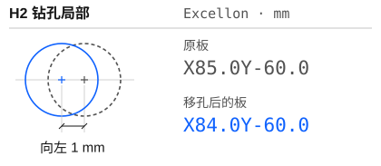

准备把板子装进外壳时，两颗螺钉要同时对准板上的安装孔。KiCad 显示“0 条违规”，怎么确认这两只孔钻对了？拿外壳图上的孔距作基准，在板图和准备发给工厂的钻孔文件上各量一次。

<h2 id="先把外壳的尺寸写下来">在板图上量两只孔的中心距</h2>

假设外壳图纸规定两只螺钉的中心距为 **30 mm**。这块教学板上有两只安装孔 H1、H2，还有两个用铜线接通的测试焊盘 TP1、TP2。原板和改板只有一处几何差别，右侧的 H2 向左移了 1 mm。[原板文件](../../assets/examples/hole-spacing/reference.kicad_pcb) · [移孔后的板文件](../../assets/examples/hole-spacing/shifted.kicad_pcb)

1. 在 KiCad 的 PCB 编辑器中打开原板。找到左侧的 H1 和右侧的 H2。
2. 选中 H1 的封装，打开“属性”，读取位置 X 和 Y。再对 H2 重复一次。这里的封装是板上定义安装孔的图形，坐标原点就在孔心。H1 的孔心在 (55, 60) mm，H2 在 (85, 60) mm。
3. 两个孔心在同一条水平线上，横坐标之差就是孔距。原板量得 85 − 55 = **30 mm**。打开改板，H2 的横坐标变成 84 mm，孔距为 **29 mm**。



比较的是**中心距**。光标如果吸附到孔边，量出来的是另一段距离。遇到孔心偏离封装原点的器件，应取实际孔心。遇到不在同一水平线上的两个孔，可在板图中用测量工具直接量两中心间的斜距。

## 为什么移了孔，规则检查还能通过？

设计规则检查（DRC）会按工程启用的规则检查板文件，例如寻找应该连通的焊盘之间缺失的铜线。这块教学板没有配套原理图，工程规则里也没有写入 30 mm 孔距。可以改动两个不同的对象，看看检查会对哪一个作出反应。

| 用 KiCad 10.0.7 检查的板 | 报告中的未连接项 | 两孔中心距 |
| --- | ---: | ---: |
| 原板 | 0 | 30 mm |
| 只移动 H2 | 0 | 29 mm |
| 保留原孔位，删除 TP1 与 TP2 之间的铜线 | 1 | 30 mm |

三次报告的 `violations` 都是空列表。第三次报告在另一个字段 `unconnected_items` 中点出了 TP1、TP2 的 1 号焊盘。要复做这一行，在原板的副本中选中两个测试焊盘之间的短铜线，删除它，运行“设计规则检查”，再打开“未连接项目”。[原板报告](../../assets/examples/hole-spacing/reference.json) · [移孔后的报告](../../assets/examples/hole-spacing/shifted.json) · [KiCad DRC 命令](https://docs.kicad.org/10.0/en/cli/cli.html#pcb_drc)

<h2 id="钻孔文件把-h2-放在哪里">发给板厂的文件把孔钻在哪里？</h2>

板厂按钻孔文件里的刀具直径和坐标加工。本例的安装孔没有孔壁镀层，KiCad 把它们导出到文件名带 `NPTH` 的钻孔文件中。用文本编辑器打开文件即可核对。[原板钻孔文件](../../assets/examples/hole-spacing/reference-NPTH.drl) · [移孔后的钻孔文件](../../assets/examples/hole-spacing/shifted-NPTH.drl)

文件头里的 `METRIC` 表示单位是毫米，`T1C3.200` 给出直径为 3.2 mm 的 1 号钻头。找到下方单独出现的 `T1`，它后面跟着两组孔心坐标。两份文件中的第一组都是 `X55.0Y-60.0`，对应 H1。第二组对应 H2，原板是 `X85.0Y-60.0`，改板是 `X84.0Y-60.0`。导出采用另一种 Y 轴方向，两个孔仍在同一条水平线上。



将两个板文件保存到同一目录，在该目录运行下面的命令即可重新导出。打开 `drill/` 里的两份 `*-NPTH.drl` 文件，按同样的方法读取孔心。[KiCad 钻孔导出说明](https://docs.kicad.org/10.0/en/cli/cli.html#pcb_export_drill_file)

```sh
kicad-cli pcb export drill --excellon-separate-th -o drill/ reference.kicad_pcb
kicad-cli pcb export drill --excellon-separate-th -o drill/ shifted.kicad_pcb
```

<h2 id="把这块板交给评测程序">发现孔距不符，该改哪里？</h2>

- **板图和钻孔文件都量出 29 mm。** 本例的偏差已经存在于板图。把 H2 调回外壳图规定的位置，再导出钻孔文件。
- **板图是 30 mm，准备交付的钻孔文件却是 29 mm。** 先核对板号和版本，再从待交付的板文件重新导出，重新量取孔距。保留两次测量结果，能看出是哪一份文件带入了偏差。
- **两份文件都量出 30 mm。** 这项名义尺寸与要求相符。判断实物能否装配，还要结合外壳图规定的孔位公差、孔径和螺钉尺寸。

如果由程序验收这块教学板，可以把结果记成两栏。移孔板的一栏写“TP1 和 TP2 已接通”，另一栏写“要求 30 mm，测得 29 mm”。读报告的人就能直接找到要修的孔。
