电源上叠着一点周期性的波动，测电压的芯片会读到多少？在 Glasgow 接口板上，工程师保持参考电压和干扰幅度不变，只改变干扰频率。旧板在一个频点的最大读数偏差达到 110 mV。这个实验帮他们找到了值得修改的那段电路。[原始测量记录](https://github.com/GlasgowEmbedded/glasgow/issues/221#issuecomment-753531753)

<h2 id="为什么要动这两路采样">电源上的波动，怎样变成读数误差？</h2>

Glasgow 用来连接和调试数字设备。板上有 A、B 两个端口，各有一颗 INA233 测量端口电压。软件读到的电压，要经过“端口 → 采样电路 → 测量芯片”这条路径。要判断误差出在哪里，工程师先给端口施加一个已知的电压。[Glasgow 项目介绍](https://glasgow-embedded.org/en/intro.html) · [INA233 引脚说明](https://www.ti.com/lit/ds/symlink/ina233.pdf#page=3)

在 revC2 板的测试中，校准器提供稳定的直流电压，信号源在直流电压上叠加三角波，模拟开关电源常见的纹波。工程师用示波器把波峰与波谷的电压差调到 200 mV，然后以 1 kHz 为步长改变频率，同时循环读取芯片。示波器记录加在输入端的纹波，芯片读数与直流参考值的差给出测量误差。[扫频设置和逐频数据](https://github.com/GlasgowEmbedded/glasgow/issues/221#issuecomment-753531753)

在 338 kHz、1.014 MHz 和 1.353 MHz 三个频点，最大偏差分别为 34、110 和 43 mV。有些频点的读数特别容易受影响。改版提交将此归因于**采样混叠**。芯片隔一段时间才取一次样。如果采样时刻总是落在波形接近波峰的位置，即使输入的平均电压稳定，一串采样值也会偏高。扫频步长为 1 kHz，两个测点之间仍可能有更窄的峰。[改版提交](https://github.com/GlasgowEmbedded/glasgow/commit/ccde65e792429e3f873e0dcdcc410eb95b17117a)

## 芯片多取几次采样再求平均，误差会小多少？

| 1.014 MHz 时的测试条件 | 读数标准差 | 最大偏差 |
| --- | ---: | ---: |
| revC2 原输入电路，原记录未注明平均次数 | 63 mV | 110 mV |
| 同一输入电路，芯片内部取 64 次采样的平均值 | 26 mV | 50 mV |
| 输入加 470 Ω 和 1 nF，芯片内部取 4 次采样的平均值 | 16 mV | 26 mV |

标准差反映一组读数有多分散。最大偏差反映这组读数中偏离参考电压最远的一次。在原输入电路上，把 INA233 的内置平均次数设为 64 后，最大偏差从 110 mV 降到了 50 mV。第三行同时改了输入电路和平均次数。26 mV 是这套组合在该频点的实测结果。要单独测出滤波器的作用，应固定平均次数，再比较加装前后的读数。[三组实测结果](https://github.com/GlasgowEmbedded/glasgow/issues/221#issuecomment-753531753)

<h2 id="把采样电路变成一道改版题">为什么选 470 Ω 和 1 nF？</h2>

改动落在测量芯片的输入支路上。端口电压沿 VSENSE 信号线通过一只串联电阻，抵达芯片的 VBUS 测量引脚。一只电容从这个引脚接地。电阻和电容组成低通滤波器，使快速变化的干扰在进入芯片前衰减。按标称值计算，时间常数为 470 Ω × 1 nF = 0.47 µs，截止频率约为 339 kHz。这个计算估计滤波器对输入信号的作用。读数误差取自上表的实际测量。

电阻和电容的取值各受一项约束。工程师试过 2.2 kΩ，即使撤掉干扰，直流读数仍低约 1%。电容则要装进已有的 0402 焊盘，并满足 40 V 的耐压要求。revC3 的原理图最终指定 470 Ω 电阻和 1 nF、50 V 的 C0G 陶瓷电容。[选型记录](https://github.com/GlasgowEmbedded/glasgow/issues/221#issuecomment-753531753) · [revC3 原理图](https://github.com/GlasgowEmbedded/glasgow/blob/ccde65e792429e3f873e0dcdcc410eb95b17117a/hardware/boards/glasgow/io_buffer.sch#L2448-L2498)

<h2 id="检查焊盘连接-再谈实物表现">怎样确认两个端口都改到了？</h2>

打开改动前后的板文件，在 PCB 编辑器中搜索 C91。两版都有这只电容的焊盘，位置和角度相同。旧板的器件值标为 DNP，新板标为 1 nF。旁边的 R60 也从 4.7 Ω 改成了 470 Ω。B 端口复用同一张子原理图，器件编号不同。表中的 R60.2 指 R60 的 2 号焊盘。[旧版板文件](https://github.com/GlasgowEmbedded/glasgow/blob/f51a08c8a9c0b90aaa6094950dae01bfdf4ad4fa/hardware/boards/glasgow/glasgow.kicad_pcb) · [新版板文件](https://github.com/GlasgowEmbedded/glasgow/blob/ccde65e792429e3f873e0dcdcc410eb95b17117a/hardware/boards/glasgow/glasgow.kicad_pcb)

| 端口 | 端口电压从哪里进入 | 电阻之后，哪些焊盘相连 | 电容哪一端接地 |
| --- | --- | --- | --- |
| A | R60.2 | R60.1、C91.2、U21.8 | C91.1 |
| B | R59.2 | R59.1、C90.2、U12.8 | C90.1 |

在 C91 的 2 号焊盘使用“高亮网络”。R60 的 1 号焊盘和 U21 的 8 脚应同时亮起。如果亮起的是大片地铜，查看所选焊盘的编号，C91 的 1 号焊盘接地。换到 C90 的 2 号焊盘，再核对 B 端口一行。若要确认手里的实物用了哪种滤波器，还要核对该板的装配记录和两个电容位置的实际装件。
