自动布线工具交回 10 块板，报告写着“平均接通 94.9%”。工程师要决定先返查哪块板，还要看每块板剩下几处连接、设计规则检查报了几个错误。PCBRouteAgent 用 Claude Opus 5.5 跑的这组板里，只有 4 块同时满足“全部接通”和“零错误”。[论文表 4](https://arxiv.org/html/2611.08175v2#S5.T4)

<h2 id="先看最后一条线">同样两块板，为什么能算出三个百分比？</h2>

元件引脚焊在板上的铜片叫焊盘。网表规定哪些焊盘应该互相连通。KiCad 用细线标出还有哪些连接需要布线，这些线常叫“飞线”。PCBWorld 的评分器先数布线前的飞线，再数布线后剩下的飞线，两者之差就是完成的连接数。一处连接可以经过多段铜线。这里数的是接通了几处。[指标定义](https://arxiv.org/html/2607.05915v4#A9)

**用两块假设的板算一次。** 小板接通 9/10 处，大板接通 90/90 处，两块都没有错误级违规。

| 读者要判断什么 | 怎么算 | 结果 |
| --- | --- | ---: |
| 随机抽一块板，它平均完成了多少？ | 小板完成 90%，大板完成 100%，两者取平均 | 95% |
| 把整批板的连接放在一起，有多少已经接通？ | (9 + 90) ÷ (10 + 90) | 99% |
| 有多少块板通过了全部连接和规则检查？ | 大板通过，小板还差一处。1 ÷ 2 | 50% |

回到论文表 4，`Rout.` 是逐板取平均，`CP` 是整板通过率。找 D3-C（大型双层板）里的 Opus 行，读到 0.949 和 0.400。后者乘以 10 得到 4 块。前者无法告诉你哪块板少了哪条线。若一块板已经接通全部连接，但仍有铜线间距错误，它的连接完成率为 100%，整板通过数仍为 0。[表 4](https://arxiv.org/html/2611.08175v2#S5.T4)

还可以用同一批板核对权重。Haiku 5.5 配 PCBRouteAgent 的逐板平均值为 91.5%，1 块整板通过。附录表 7 把十块板的连接合在一起，得到 1,080/1,178，约 91.7%。后一个算法让连接多的板占更大权重。[逐板平均和通过数](https://arxiv.org/html/2611.08175v2#S5.T4) · [连接总数](https://arxiv.org/html/2611.08175v2#A3.T7)

<h2 id="少了哪些连接-打开失败板看一次">有连接缺失，怎样在板图上找到原因？</h2>

在同一块大型板上，Haiku 配 PCBRouteAgent 完成了 84/86 处连接，配 PCBWorld 基线只完成 10/86 处。两份板都未通过。要判断哪份板还要返工多少，保留“还差 2 处”和“还差 76 处”这两个数。要找到返工位置，还要打开板图。[同一块板的两份结果](https://arxiv.org/html/2611.08175v2#A4.SS1)

论文图 5 展示了另一块板，参考设计接通 83/83 处，Opus 接通 70/83 处。可以从一条缺失信号往回查。[图 5 和布线过程](https://arxiv.org/html/2611.08175v2#A4.SS2)

1. **找两个端点。** 控制器要向传感器送时钟 SCL，并通过 SDA 传数据。先在图中找到控制器和传感器两端的引脚。
2. **沿已铺的铜线追。** 控制器焊盘附近很挤。模型用过孔换到另一层，信号线从控制器旁绕了出来。图里的虚线是重试时的引导路径。判断是否接通要看实际铺下的铜线。
3. **回看哪一步占了空间。** 模型先布传感器电源线，堵住了信号线靠近传感器的通道。修复步骤撤掉了未完成的试走线，却留下了电源线。参考板给这两根信号线选了不同的路径和铜层。

即使全部接通，也还有单项约束值得查。论文另一块板的 55 处连接全部完成。USB 的 D+、D− 是成对传输的信号。参考板两线并行，各长 30.25 mm。模型分开布线，两线长 34.03 和 36.49 mm，相差 2.46 mm。规划输入只给了单线线宽和间距，缺少两线的配对关系。要判断这块板的 USB 接口能否可靠工作，还需要电气验证。[USB 走线对照](https://arxiv.org/html/2611.08175v2#A4.SS3)

<h2 id="再看哪些板进入分母">两组成绩都叫 D3-B，用的是同一批板吗？</h2>

D3-B 是 PCBWorld 的中型板组。PCBRouteAgent 使用其中 10 块双层板，按焊盘数量分档，每档取一块。Opus 的最终结果是 10/10。作者允许模型响应失败后重试，也修复了走线角度，每块板最后交一份文件。[十板清单，表 28](https://arxiv.org/html/2607.05915v4#A15.T28) · [实验设置](https://arxiv.org/html/2611.08175v2#S4)

CADET 留下 141 块做测试，另用 142 块参考板统计训练板应具备的特征。我们按板卡目录名逐项核对了两个清单。十板中的 **6 块**在 CADET 测试集，编号为 `0113`、`0174`、`0232`、`0288`、`0316`、`0344`。其余 4 块在参考板集。例如，搜索 `0174_sensorboard_DiffIR` 可以在表 28 和测试清单中各找到一次。[测试清单](https://github.com/LGAI-Research/CADET/blob/7bea0d51d3ee96bacf2915fd0d3e119fa4404cc5/cadet/configs/splits/boards_d3b_test.txt) · [参考板清单](https://github.com/LGAI-Research/CADET/blob/7bea0d51d3ee96bacf2915fd0d3e119fa4404cc5/cadet/configs/splits/boards_d3b_fit.txt)

若要对这 6 块板逐板比较，可用相同起始文件、设计规则和时间上限重跑两种方法，再比较每块板的未接通项和规则错误。CADET 报告的 67.2% 汇总了四个训练随机种子和重复试验。只凭这个百分比无法算出某一次试验通过了哪几块。[CADET 实验设置](https://arxiv.org/html/2611.16913v1#S4.SS1)

<h2 id="最后看允许试几次-计时从哪里开始">每块板多试两次，花多少时间？</h2>

| 141 块 D3-B 测试板 | 平均整板通过率 | 平均每板耗时 |
| --- | ---: | ---: |
| CADET，每板一次 | 67.2% | 15.5 秒 |
| CADET，每板三次择优 | 79.8% | 47.6 秒 |
| Freerouting，每板一次 | 65.6% | 45.6 秒 |

两种设置每块板最终都只交一份结果。`@1` 允许跑一次，`@3` 允许跑三次再选一份。在同一台服务器上，CADET 多试两次、取三次中最好的一份，平均每板多花 32.1 秒，整板通过率提高 12.6 个百分点。作者先选整板通过的结果，同分时再选布线评分增益较高的一份。[CADET 表 2](https://arxiv.org/html/2611.16913v1#S4.T2)

读另一篇论文时要重新核对计时。PCBWorld 主表给随机方法每板五次机会，按评分增益选一份结果。时间栏记录单次尝试的平均耗时。如果每块板只允许运行一次，应查附录的单次试验表。[PCBWorld 计时与选板规则](https://arxiv.org/html/2607.05915v4#S4.SS3) · [单次结果，表 22](https://arxiv.org/html/2607.05915v4#A12.T22)
