原理图上，两只电源脚都接到了同一条电源线。到了板图上，怎样查出其中一只脚漏接了一段铜线？Raspberry Pi 的 RP2040 最小系统板有一条这样的电源线，给芯片内核供电。打开公开的 KiCad 工程就能检查整条线路，也能在副本上试一次断线。[下载官方 R3-S1 工程](https://pip.raspberrypi.com/documents/RP-008296-DS)

<h2 id="从稳压器输出追到内核">先从原理图找出供电路径</h2>

解压 R3-S1 工程，用 KiCad 打开目录中的 `.kicad_pro` 工程文件。双击同名的 `.kicad_sch` 原理图文件，找到编号为 U3 的 RP2040 芯片。它内部有一个稳压器，把输入电压降到内核使用的电压。这块板把稳压器的输出引出了芯片，再用板上的铜线送回两个内核电源脚。图中相同的网络名表示这些引脚在设计上应该相连。[RP2040 硬件设计指南，第 2 章](https://datasheets.raspberrypi.com/rp2040/hardware-design-with-rp2040.pdf)

| 看哪个引脚 | 原理图上的名称 | 它在这条路径上做什么 |
| --- | --- | --- |
| U3 的 44 脚 | VREG_IN，接 `+3V3` | 从板上稳压器 U1 接收 3.3 V，给芯片内的稳压器供电。 |
| U3 的 45 脚 | VREG_VOUT，接 `+1V1` | 芯片内的稳压器从这里输出 1.1 V。 |
| U3 的 23、50 脚 | DVDD，均接 `+1V1` | 电压通过板上的铜线回到这两只脚，给数字内核供电。 |

回到工程窗口，双击同名的 `.kicad_pcb` 板文件。找到 U3 的 45 号焊盘，对它使用“高亮网络”。焊盘是芯片引脚焊到板上的位置。23、45、50 号焊盘应该一起亮起。紧挨着的 44 号焊盘应属于另一条电源线。如果高亮后看到的是 `+3V3`，先检查是否选中了 44 号焊盘。



除了 U3 上的三个焊盘，`+1V1` 还连接 C6、C7、C8 各自的 1 号焊盘。C6 和 C7 各为 100 nF，C8 为 1 µF，三只电容的 2 号焊盘都接地。这样可以逐一解释板图中六个器件焊盘的来历。四个过孔负责在铜层之间连接这条电源线，单独计数。[官方板文件、原理图与物料表](https://pip.raspberrypi.com/documents/RP-008296-DS)

## 删掉一段铜线，哪项检查会发现？

1. 在官方原板的 PCB 编辑器中运行“设计规则检查”，查看“未连接项目”。原板的结果为 0 项。
2. 复制整个工程目录。打开副本的板图，放大 U3 的 50 号焊盘。找到焊盘朝过孔延伸的正面铜线（层名 `F.Cu`）。在这版板上，线宽为 0.2 mm，两个端点分别为 (99.8, 96.5625) mm 和 (99.8, 95.199994) mm。
3. 只删除这一段铜线，保留焊盘和过孔。保存副本，再对 45 号焊盘使用“高亮网络”。50 号焊盘仍标为 `+1V1`，它的网络分配没有变。
4. 在副本中重新运行“设计规则检查”。打开“未连接项目”，双击新增的一项。报告指出 U3 的 50 号焊盘和一段背面铜线（`B.Cu`）。中间的过孔连接正反两面，缺口位于刚移除正面铜线的支路。

| KiCad 10.0.7 检查结果 | 官方原板 | 删除一段线的副本 |
| --- | ---: | ---: |
| `+1V1` 的器件焊盘数 / 过孔数 | 6 / 4 | 6 / 4 |
| 原理图与板图的一致性问题 | 0 | 0 |
| 板上未连接项目 | 0 | 1 |

若副本仍有 0 个未连接项目，核对编辑器当前打开的文件路径，再检查 50 号焊盘旁的正面线段是否已经删除。若出现了其它断点，双击报告中的每一项，核对端点和铜层。原板和副本在本次安装环境中各有 34 条封装库警告，这些警告在报告中另列。[KiCad 设计规则检查](https://docs.kicad.org/10.0/en/pcbnew/pcbnew.html)

<h2 id="把原理图和板文件各导出一次">用命令行分别读取原理图和板文件</h2>

要重复比较不同版本的板，可以把上面的检查保存成文件。在空目录中运行下面的命令，先下载 R3-S1，再用 KiCad 10.0.7 导出两份清单。`schematic.xml` 列出原理图规定的连接，`board.d356` 从板文件导出各焊盘所属的网络。后者使用电气测试文件格式 IPC-D-356。[KiCad 命令行参考](https://docs.kicad.org/10.0/en/cli/cli.html)

```sh
curl -fL -o minimal.zip https://pip-assets.raspberrypi.com/categories/814-rp2040/documents/RP-008296-DS-2-Minimal-KiCAD.zip
unzip -q minimal.zip
cd RPI-RP2040-MINIMAL_R3-S1_public
board=RPI-RP2040-MINIMAL_R3-S1
kicad-cli sch export netlist --format kicadxml -o schematic.xml "$board.kicad_sch"
kicad-cli pcb export ipcd356 -o board.d356 "$board.kicad_pcb"
```

<h2 id="比对六个焊盘">查出哪一个焊盘多了或少了</h2>

把下面的代码保存为 `check_pads.py`，与刚导出的 `schematic.xml` 和 `board.d356` 放在同一目录。预期清单来自 R3-S1 的原理图。在这块板导出的 IPC-D-356 文件里，`327` 记录对应表贴焊盘，`317` 且带有 `VIA` 的记录对应过孔。

```python
import re
from pathlib import Path
from xml.etree import ElementTree

expected = {"U3.23", "U3.45", "U3.50", "C6.1", "C7.1", "C8.1"}
root = ElementTree.parse("schematic.xml")
nodes = root.findall(".//nets/net[@name='+1V1']/node")
schematic_pads = {f"{n.get('ref')}.{n.get('pin')}" for n in nodes}

board_pads = set()
via_count = 0
for line in Path("board.d356").read_text().splitlines():
    match = re.match(r"^327\+1V1\s+(\w+)\s+-(\d+)\s", line)
    if match:
        board_pads.add(f"{match[1]}.{match[2]}")
    if line.startswith("317+1V1 ") and " VIA " in line:
        via_count += 1

for source, pads in (("schematic", schematic_pads), ("board", board_pads)):
    print(source, "missing:", sorted(expected - pads), "extra:", sorted(pads - expected))
print("board vias:", via_count)
```

在该目录的终端运行 `python3 check_pads.py`。原板的两行 `missing` 和 `extra` 列表都应为空，`board vias` 应为 4。若只有板文件的列表有差异，例如 `missing` 出现 `U3.50`，先查看该焊盘的网络属性，再核对原理图和板文件的版本。若两份列表都匹配，仍需检查铜线是否接通。

在原工程和副本各自的目录运行下面的命令。`--schematic-parity` 同时检查原理图和板文件是否一致。原板应输出 `unconnected: 0 schematic parity: 0`，断线副本应输出 `unconnected: 1 schematic parity: 0`。这项结果可以定位设计文件中的断点。要确认做出来的板在负载下能否维持 1.1 V，还需要测量实物电压。

```sh
board=RPI-RP2040-MINIMAL_R3-S1
kicad-cli pcb drc --schematic-parity --severity-all --format json -o drc.json "$board.kicad_pcb"
python3 -c 'import json; r=json.load(open("drc.json")); print("unconnected:", len(r["unconnected_items"]), "schematic parity:", len(r["schematic_parity"]))'
```
